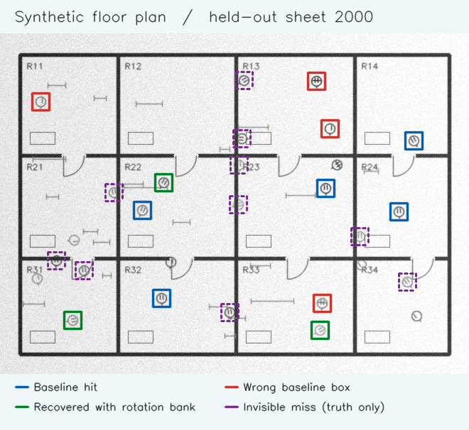

# Confidence can't show you a missed symbol

On 120 held-out synthetic construction drawings, **1,590 of 1,854 baseline errors were missed symbols with no overlapping box** (85.76%, 95% CI 83.21–88.33%). A reviewer sorting the emitted boxes by score would have no box to inspect for any of those symbols. The detector is an OpenCV template-matching baseline. Bobyard's model was never evaluated.



## Held-out results

The baseline detected 565 of 2,155 symbols (26.22% recall, 95% CI 23.65–28.78%). The remaining errors were 264 wrong boxes (14.24% of all errors, 95% CI 11.67–16.79%). There were zero missed symbols with an overlapping baseline box on these sheets.

| Second pass | Invisible misses recovered, 95% CI | Extra boxes per sheet, 95% CI | Extra wrong boxes per sheet, 95% CI |
| --- | ---: | ---: | ---: |
| Lower upright threshold | 291/1,590 **18.30%** (15.78–20.94%) | 501 total, **4.17** (3.72–4.65) | 210 total, 1.75 (1.48–2.02) |
| Rotation bank | 469/1,590 **29.50%** (26.53–32.46%) | 626 total, **5.22** (4.65–5.77) | 157 total, 1.31 (1.02–1.61) |

The rotation bank recovered **11.19 percentage points more** (95% CI 8.58–13.85) at **1.04 more boxes per sheet** (95% CI 0.61–1.47). Both passes used the same tuning budget and had different realized review loads.

## Method

Each sheet has 13–24 labeled outlet-like symbols, similar distractors, walls, door swings, labels, and dimension marks. Symbols vary in angle and ink strength. Blur, a brightness gradient, and noise simulate scanning. OpenCV scores 25-pixel square templates with normalized correlation. A hit requires a box center within eight pixels of a truth center, with one box per symbol. An unmatched symbol is invisible if none of the emitted baseline boxes intersect its truth box. Every unmatched emitted box counts as wrong.

Using seeds 1000–1047, the baseline maximized hits under a mean budget of two wrong boxes per sheet and selected a score threshold of **0.77**. Each second pass kept the baseline boxes and maximized newly surfaced invisible misses under a mean budget of six added boxes per sheet. Thresholds were **0.73** for the upright template and **0.83** for the best of seven templates from −90° to 90°. All thresholds were fixed before evaluating seeds 2000–2119. The 95% intervals use 10,000 paired bootstrap resamples of whole test sheets with seed 2026.

The results depend on the synthetic symbol family, scan settings, and matching rules. The same source symbol generates both the synthetic targets and templates. Review workload is measured in boxes, and review time and human accuracy were not measured.

## Reproduce

Run with Python 3.13 in a fresh virtual environment.

```sh
python -m pip install -r requirements.txt
python -m unittest -v
python demo.py --image example.png
```
